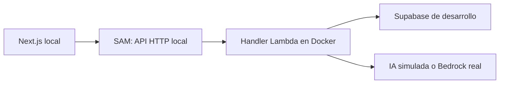

# Estrategia de infraestructura AWS del MVP

Estado: propuesta de adopción de AWS SAM, pendiente de revisión del equipo.
Fecha: 2026-11-09. Issue: [#10](https://github.com/cbraian42/Edux/issues/10).

## Objetivo y alcance

Elegimos **AWS Serverless Application Model (SAM)** para describir y gestionar la infraestructura AWS de EDUX. La prioridad del MVP es aprender los servicios cloud y construir el recorrido funcional acordado con una configuración reproducible y versionada.

Esta decisión conserva la arquitectura del [README](../../README.md) y del [diagrama cloud](edux-cloud-architecture.drawio): Next.js en Vercel, API Gateway, Lambda en Node.js/TypeScript, Cognito, PostgreSQL en Supabase, Bedrock y CloudWatch. La [especificación funcional](../functional-specification.md) y el [modelo de datos](../data-model.md) siguen definiendo el comportamiento y las entidades del MVP.

El issue entrega una comparación, una elección justificada, una ubicación para IaC y un ejemplo ilustrativo. No crea recursos AWS, despliega Lambdas, define IAM definitivo ni automatiza GitHub Actions. El cierre requiere un PR revisado y aprobado por el otro integrante del equipo.

## Comparación de alternativas

La curva de aprendizaje y la complejidad siguientes son valoraciones para este proyecto, cuyo backend ya utiliza TypeScript y tiene una función `health`.

| Criterio | AWS SAM | AWS CDK | Terraform |
| --- | --- | --- | --- |
| Definición | YAML con abreviaturas para recursos serverless y recursos CloudFormation estándar. | Código, por ejemplo TypeScript, que genera plantillas CloudFormation. | HCL declarativo y providers para gestionar recursos. |
| Curva de aprendizaje | Acotada para Lambda/API Gateway; requiere entender recursos, referencias, IAM y CloudFormation. | El lenguaje resulta familiar; agrega constructs, síntesis y bootstrap del entorno. | Agrega HCL, providers, planes y gestión del estado. |
| Lambda y API Gateway | Integración directa entre funciones y eventos HTTP; CLI para empaquetado y pruebas locales. | Constructs para definir funciones, APIs e integraciones. | Recursos para ambos servicios; el proceso de compilación y empaquetado debe integrarse por separado. |
| Cognito e IAM | Se declaran mediante recursos CloudFormation dentro de la misma plantilla. | Se declaran mediante constructs y recursos de CloudFormation. | Se declaran mediante recursos del provider AWS. |
| Versionado | Plantillas y configuración sin secretos en Git. | Código y dependencias en Git. | Configuración y archivo de bloqueo de providers en Git; estado fuera de Git. |
| GitHub Actions | Ejecutar validaciones, build y deploy con SAM CLI. | Ejecutar validaciones, síntesis y deploy con CDK CLI. | Compilar el backend y ejecutar plan/apply, con acceso compartido al estado. |
| Estado de infraestructura | Gestionado por CloudFormation en AWS. | Gestionado por CloudFormation en AWS. | Requiere acordar almacenamiento, acceso y bloqueo; por ejemplo backend S3. |
| Complejidad para EDUX | Menor trabajo inicial por su foco serverless. | Alternativa válida si queremos priorizar infraestructura programada en TypeScript. | Alternativa válida si aprender Terraform es también un objetivo explícito. |
| Limitación relevante | Vinculado a AWS; YAML puede volverse extenso al crecer. | Las abstracciones pueden ocultar recursos y permisos que el equipo debe comprender. | El estado y el empaquetado agregan trabajo al recorrido inicial. |

Las tres opciones permiten resolver la infraestructura AWS prevista. Elegir una herramienta no mejora por sí mismo los costos, la seguridad o la escalabilidad de la arquitectura.

## Decisión y motivos

Adoptar SAM para el MVP permite aprender IaC mientras trabajamos directamente con Lambda, API Gateway, IAM y CloudFormation. Reduce el trabajo inicial de integrar despliegue y ejecución local del backend. También admite Cognito y otros recursos CloudFormation: no queda limitado a Lambda.

Terraform aporta conocimientos transferibles a otros proveedores, pero esa ventaja no es una necesidad actual. Usar Vercel y Supabase junto con AWS no exige gestionar todo con una única herramienta. CDK aprovecharía TypeScript, aunque incorpora conceptos y abstracciones que todavía no necesitamos.

Revisaremos la elección si aparecen necesidades concretas de gestionar varios proveedores con un mismo flujo, reutilizar infraestructura compleja o si el equipo decide priorizar el aprendizaje de Terraform/CDK. Esa revisión requerirá planificar la propiedad y migración de los recursos existentes.

## Recursos y responsabilidades

| Componente | Tratamiento previsto |
| --- | --- |
| Lambda | Código en `backend/`; runtime, handlers y configuración en SAM. |
| API Gateway | HTTP API y rutas; autorizador JWT de Cognito cuando se implemente autenticación. |
| Cognito | User Pool y cliente declarados como recursos CloudFormation; implementación diferida. |
| IAM | Roles de ejecución y permisos mínimos para cada función; el detalle se definirá al incorporar las integraciones. |
| CloudWatch | Logs con retención explícita y observabilidad a ampliar según necesidades. |
| Bedrock | Consumo desde Lambda mediante SDK y permisos IAM; modelo y región pendientes de validar. No se despliega un modelo por agregar SAM. |
| Supabase | PostgreSQL administrado; migraciones versionadas y conexión desde el backend, fuera del alcance de SAM. |
| Vercel | Despliegue del frontend y variables de configuración por separado. |

Inicialmente no se propone conectar Lambda a una VPC propia: las dependencias previstas son accesibles mediante endpoints públicos. La configuración de red se revisará si cambian esas necesidades.

Los secretos no se guardan en plantillas, archivos de configuración versionados ni outputs. El mecanismo para entregarlos al backend desplegado se definirá antes del primer despliegue. Un MCP es una herramienta del asistente para consultar o administrar servicios; no reemplaza SAM ni las conexiones de ejecución de la aplicación.

## Desarrollo local y validación cloud

El mismo handler TypeScript podrá ejecutarse localmente o en AWS. La lógica de negocio se mantendrá separada de la interpretación del evento y la construcción de la respuesta HTTP para poder probarla sin Docker.



SAM local utiliza Docker para ejecutar las funciones y representar el recorrido HTTP. No levanta una copia completa de AWS. Un backend local puede consumir servicios remotos; las llamadas reales a servicios cloud están sujetas a sus condiciones y costos.

Proponemos trabajar en tres niveles:

1. Pruebas de reglas de negocio con dependencias simuladas y datos ficticios, sin AWS.
2. Pruebas HTTP con SAM local y persistencia de desarrollo; respuestas de IA simuladas durante el trabajo cotidiano.
3. Pruebas de integración en un stack AWS `dev` para comprobar permisos reales, autenticación, API Gateway, Bedrock y logs antes de dar por terminada una integración.

La integración con Cognito se difiere para avanzar primero con las reglas de negocio en local. Estas reglas deben recibir una identidad de docente desde el comienzo y filtrar sus datos; localmente se utilizará una identidad de prueba. Esa identidad de prueba no se aceptará como mecanismo de autenticación en un despliegue cloud. Cognito seguirá siendo el proveedor de autenticación acordado, y un User Pool de desarrollo será un recurso real en AWS.

El único endpoint sin autenticación mostrado en el ejemplo es `GET /health`, que no accede a datos de negocio. La validación JWT y el aislamiento entre docentes deberán estar comprobados antes de exponer rutas de negocio en AWS. La emulación local no demuestra que los permisos del rol Lambda desplegado funcionen.

GitHub Actions queda para otra tarea. El flujo futuro podrá ejecutar las comprobaciones del backend, validar y compilar SAM, revisar los cambios y desplegar con credenciales temporales mediante OIDC. `sam sync --watch` será opcional para un entorno de desarrollo; no reemplazará el flujo formal de despliegue.

## Ubicación en el repositorio

La estructura propuesta distingue el ejemplo de la configuración operativa futura:

```text
infra/
  examples/
    health.template.yaml    # Ejemplo ilustrativo de este issue.
  template.yaml             # Futuro: plantilla operativa, todavía no creada.
  samconfig.toml            # Futuro: parámetros no secretos, si se necesita.
backend/
  src/functions/health/handler.ts
docs/architecture/
  infrastructure-strategy.md
```

No hay una plantilla operativa en la raíz de `infra/` en esta entrega. Antes de crearla habrá que validar el empaquetado, definir parámetros por entorno y comprobar el recorrido local. No se agregan entornos productivos ni múltiples stacks en este issue.

## Ejemplo explicado para el equipo

Ver [plantilla ilustrativa](../../infra/examples/health.template.yaml). **No fue validada con SAM CLI, ejecutada con Docker ni desplegada en AWS.** Su propósito es mostrar cómo se expresa la arquitectura y cómo se vincula al handler existente. No configura Cognito, Bedrock, Supabase, CORS ni permisos definitivos.

Puede leerse como una receta:

1. `Transform` indica que CloudFormation debe interpretar las abreviaturas de SAM.
2. `HealthApi` describe una HTTP API.
3. `HealthFunction` identifica el código del backend y el handler que respondería la solicitud. `CodeUri` se resuelve respecto de la ubicación de esta plantilla.
4. `Metadata` describe un posible empaquetado de TypeScript con esbuild, en formato ESM. Preparar y verificar esa herramienta queda para la siguiente tarea; no se agrega una dependencia al backend en este issue.
5. El evento `GetHealth` conecta `GET /health` con la función. SAM genera la integración y el permiso para que API Gateway invoque Lambda.
6. Al no declarar un rol propio, SAM genera un rol de ejecución con permisos básicos de logs. No concede acceso a Bedrock ni a la base de datos.
7. `HealthLogGroup` ilustra una retención de logs de siete días. Ese valor es una propuesta para desarrollo.

```text
GET /health → API Gateway → Lambda → handler existente → {"status":"ok"}
```

En local, SAM representaría la API y ejecutaría ese handler en Docker. En AWS, API Gateway invocaría una Lambda real. Definir la receta en YAML no ejecuta ninguno de esos recorridos ni crea recursos por sí solo.

Como orientación para la siguiente tarea, desde la raíz del repositorio:

```powershell
# Requiere preparar SAM CLI, Docker y el empaquetado con esbuild.
sam validate --lint --template-file infra/examples/health.template.yaml
sam build --template-file infra/examples/health.template.yaml
sam local start-api --template .aws-sam/build/template.yaml
```

Estos comandos son una guía pendiente de ejecución, no evidencia de validación. El ejemplo no incluye instrucciones de despliegue. Antes de promoverlo a plantilla operativa se revisarán runtime vigente, empaquetado ESM, permisos y comportamiento local.

## Trabajo posterior

- Preparar SAM CLI y Docker; incorporar y fijar el empaquetado necesario.
- Validar la plantilla operativa y comprobar `GET /health` localmente.
- Implementar persistencia y reglas por docente con datos de prueba.
- Crear el entorno AWS `dev` y validar las integraciones reales.
- Incorporar Cognito y verificar autenticación y aislamiento antes de publicar rutas de negocio.
- Automatizar validaciones y despliegue en un issue específico.

## Fuentes oficiales

Consultadas el 2026-11-09:

- [Definición y alcance de SAM](https://docs.aws.amazon.com/serverless-application-model/latest/developerguide/what-is-sam.html).
- [Plantillas SAM y recursos CloudFormation](https://docs.aws.amazon.com/serverless-application-model/latest/developerguide/sam-specification-template-anatomy.html).
- [Referencia de funciones SAM y rol generado](https://docs.aws.amazon.com/serverless-application-model/latest/developerguide/sam-resource-function.html).
- [Empaquetado TypeScript con esbuild](https://docs.aws.amazon.com/serverless-application-model/latest/developerguide/serverless-sam-cli-using-build-typescript.html).
- [Resolución de rutas en sam build](https://docs.aws.amazon.com/serverless-application-model/latest/developerguide/sam-cli-command-reference-sam-build.html).
- [Autorización JWT con SAM](https://docs.aws.amazon.com/serverless-application-model/latest/developerguide/serverless-controlling-access-to-apis-oauth2-authorizer.html).
- [Pruebas HTTP locales](https://docs.aws.amazon.com/serverless-application-model/latest/developerguide/using-sam-cli-local-start-api.html).
- [Pruebas de aplicaciones Lambda y límites de emulación](https://docs.aws.amazon.com/lambda/latest/dg/testing-guide.html).
- [Acceso de red de Lambda](https://docs.aws.amazon.com/lambda/latest/dg/configuration-vpc.html).
- [SAM con GitHub Actions](https://docs.aws.amazon.com/serverless-application-model/latest/developerguide/deploying-using-github.html).
- [Sincronización de desarrollo con SAM](https://docs.aws.amazon.com/serverless-application-model/latest/developerguide/using-sam-cli-sync.html).
- [Síntesis de CDK](https://docs.aws.amazon.com/cdk/v2/guide/configure-synth.html) y [bootstrap](https://docs.aws.amazon.com/cdk/v2/guide/bootstrapping.html).
- [Provider AWS de Terraform](https://registry.terraform.io/providers/hashicorp/aws/latest/docs) y [backend S3 y bloqueo del estado](https://developer.hashicorp.com/terraform/language/backend/s3).
